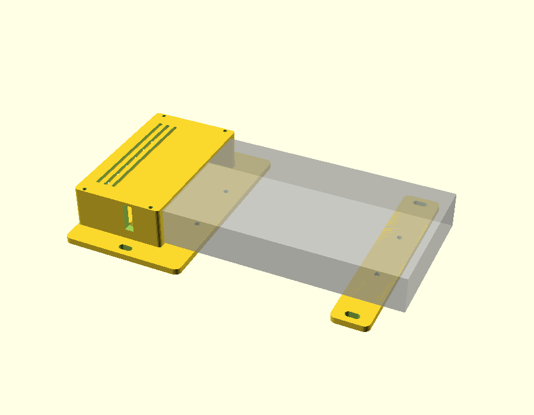

# Rack-side USB-C charging station

3D-printable mount for a **Mean Well LRS-200-24** (24 V, 200 W) power supply and up to **8× CKCS U1E** USB-C PD boards (8–30 V in, up to 65 W out each), bolted to the side panel of a server rack. Every part prints on a **200×200 mm bed**.



The PSU's metal case is its own enclosure. Printed parts:

- **End cap**: bracket, cover over the PSU's screw terminals, and holder for the USB boards
- **Lid** for the cap
- **Far bracket** for the other end of the PSU
- **Sleds**: one carrier plate per USB board

## Parts

| File | Part | Size (mm) | Qty |
|---|---|---|---|
| `cap.stl` | End cap: bracket + terminal cover + USB holder | 100 × 167 × 36 | 1 |
| `lid.stl` | Cap lid with vents and board-retaining combs | 74.5 × 129 × 8.5 | 1 |
| `far.stl` | Far-end bracket | 30 × 167 × 5 | 1 |
| `sled.stl` | Board carrier plate | 32 × 28 × 2.2 | 1 per board |
| `test_port_sled.stl` | Fit test: port-wall corner of the cap + 1 sled | 37.5 × 78.5 × 36 | optional |

**Print the test piece first.** It checks the USB socket fit, the sled slots and the sled corners before you commit to the full cap.

Material: **PETG or ASA**. PLA softens near a warm PSU.

## Hardware

| Item | Qty | Use |
|---|---|---|
| M4 × 8 countersunk | 4 | Brackets to the PSU's bottom M4 holes. The datasheet allows **3 mm max** into the PSU; the plate is 5 mm, so nothing longer than 8 mm. |
| M5 + rack hardware | 4 | Brackets to the rack side panel (slotted holes) |
| M3 self-tapping, ~12 mm | 4 | Lid to cap |
| 2G × 6.5 self-tapping | 4 per board | U1E board to sled, through its castellated half-holes |
| Zip tie | 1 | AC cord strain relief (anchor inside the cap) |

## How it goes together

1. Screw each U1E board flat onto a sled. The bosses face the board and the screws go through its edge half-holes. The USB-C port sits at the sled's front edge.
2. Drop the sleds into the floor slots in the cap with the ports facing the port wall. The receptacle seats in a tight 1 mm socket, so the plate takes the side loads from plugging in, not the PCB.
3. Wire the board inputs to the PSU's +V/−V terminals. Bring the AC cord in through the side notch and zip-tie it to the anchor.
4. Fit the cap and the far bracket to the PSU's bottom M4 holes, then screw both to the rack.
5. Fit the lid. Its combs hold the top edges of the sleds.

## Customising

Everything is parametric in [`usb_psu_enclosure.scad`](usb_psu_enclosure.scad). The calibration settings at the top of the file are the ones to change for your parts:

| Parameter | Default | What it sets |
|---|---|---|
| `N` | 8 | Number of USB boards |
| `PITCH` | 14 | Spacing between boards |
| `RECEPT` | `[3.7, 10.25]` | USB-C socket width × height. Tune it to your printer from the test print. |
| `HH` | `[4, 25]` | Half-hole positions on the board (measured) |
| `CORD_D` | 7.5 | AC cord notch (fits a 6.5–7 mm cord) |
| `RACK_D` | 5.5 | Rack screw clearance |

Each part is rendered and exported from the command line:

```bash
openscad -o cap.stl -D 'part="cap"' usb_psu_enclosure.scad
```

`part` can be `cap`, `lid`, `far`, `sled`, `test` or `all`. `all` shows the assembly with a ghost of the PSU.

## Power budget

At 8 boards × 65 W = 520 W worst case against a 211 W PSU, only **about 3 ports can deliver a full 65 W at once**. The setup suits phones, tablets and mixed loads. If you overload the PSU, it protects itself by switching off and retrying (hiccup mode, at 110–140% load per its datasheet).

The U1E needs **≥ 21.5 V input** for its 20 V / 65 W profile. That's why this design uses the 24 V LRS model.

## Safety

- The PSU's screw terminals carry mains voltage. The cap covers them. Earth the PSU's FG terminal, and don't power it with the cap off.
- The air gap between neighbouring boards is about 2 mm, below the 3–5 mm the U1E seller suggests. That's fine for phone charging, but with several ports at a sustained 65 W the boards will run warm.

## Sources

Dimensions come from the Mean Well LRS-200 datasheet (case 207), the CKCS U1E spec sheet, and measurements of real parts. The datasheets aren't included here; get them from Mean Well and from your board seller.

## License

[CC BY-SA 4.0](https://creativecommons.org/licenses/by-sa/4.0/) © srmiles. You may share and remix this design, including commercially, as long as you credit it and release your changes under the same license. Full text in [LICENSE](LICENSE).
